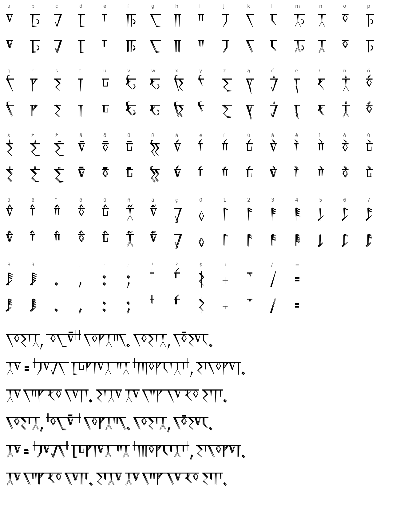

## Birdfolk_Kuropatwa
Prace nad autorskim i/lub ogólnodostępnym fontem inspirowanym Humblescratch oraz alfabetem. 
Ma być on nazywany Birdfolk czyli Zwierzoludzki Wspólny.

#Dotyczy on:
- [ ] D<sub>&</sub>D Core
  - [ ] Tabaxi
  - [ ] Kenku
- [ ] D<sub>&</sub>D Addons
  - [ ] Loxodon
  - [ ] Leonin
- [ ] D<sub>&</sub>D Official SubGames
  - [ ] Humblewood
    - [ ] Birdfolk
      - [ ] Corvum
      - [ ] Gallus
      - [ ] Luma
      - [ ] Raptor
      - [ ] Strig
    - [ ] Humblefolk
      - [ ] Vulpin
      - [ ] Mapach
      - [ ] Cervan
      - [ ] Jerbeen
      - [ ] Ursine

I wiele innych...

---

## Kuropatwa: webfont

Własne pismo Birdfolk. Litery wiszą pod gałęzią łączącą słowo, a warstwy pochodzenia widać
w kształcie: rdzeń Corvum, dopisek ssaków (łuk warg), belka Loxodon, dopiski imperialne.



**Gotowe pliki** w `dist/`: `kuropatwa.woff2|woff|ttf`, `kuropatwa-drap.woff2|woff|ttf`, `kuropatwa.css`.

```html
<link rel="stylesheet" href="kuropatwa.css">
<span class="kuropatwa">kosen, !ogä!! kornik.</span>
<span class="kuropatwa-drap">kosun.</span>
```

**Wzornik z transliteratorem:** `specimen/index.html` (otwórz lokalnie w przeglądarce).

**Budowanie:**

```bash
pip install -r requirements.txt
python3 tools/build.py      # fonty do dist/ + wzornik
python3 -m pytest -q        # testy (zestaw znaków, rozróżnialność w 16/24 px, deterministyczność)
python3 tools/preview.py    # docs/preview.png
```

Kształty znaków: `src/kuropatwa/glyphs.py`. Kreski i style: `src/kuropatwa/render.py`.
Projekt: `docs/superpowers/specs/`, dziennik decyzji: `docs/KAMIENIE.md`.

